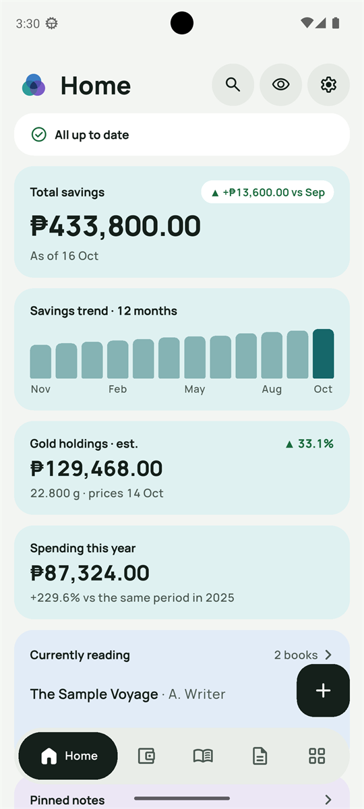
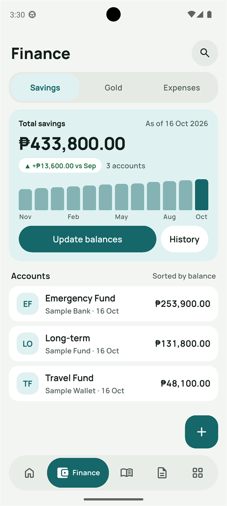
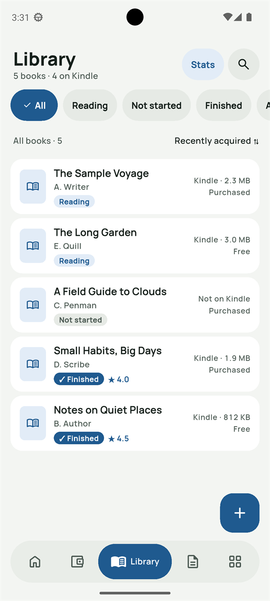
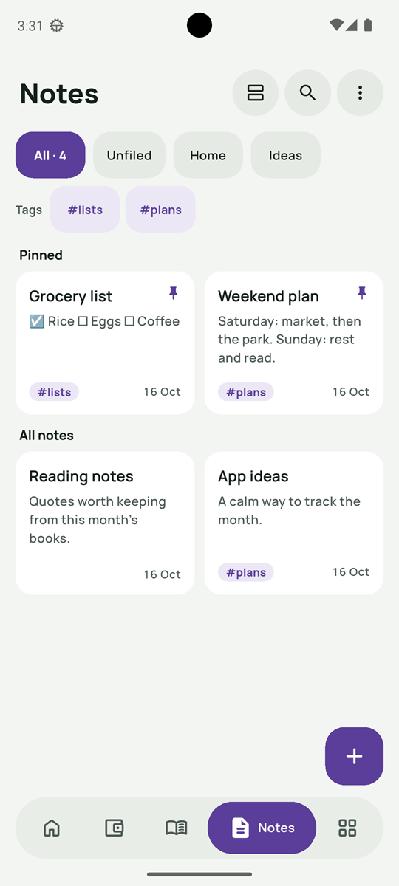
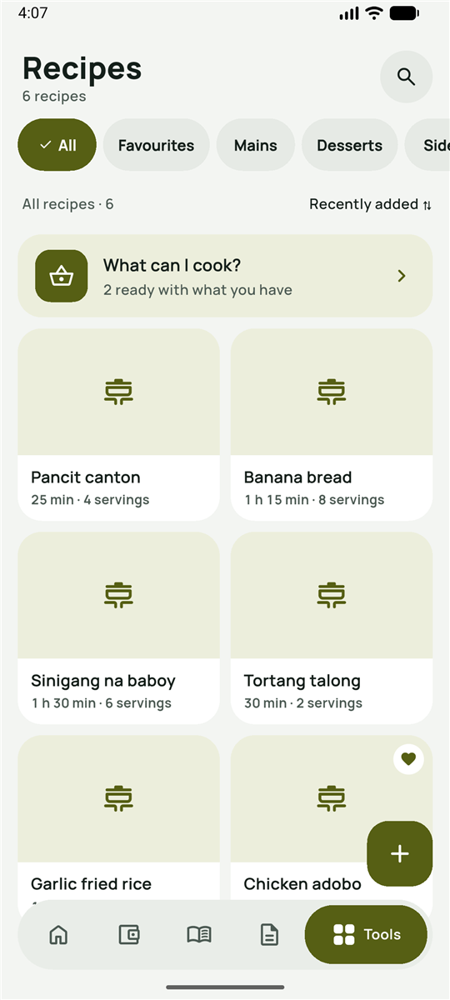
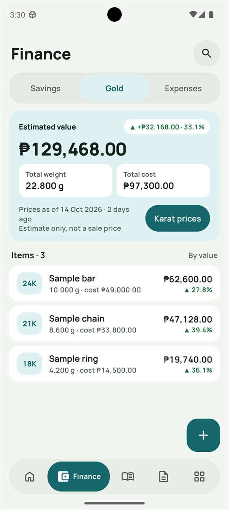
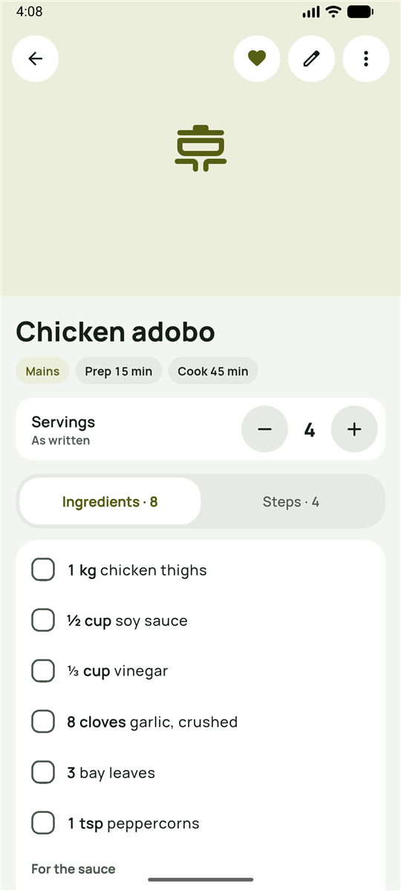
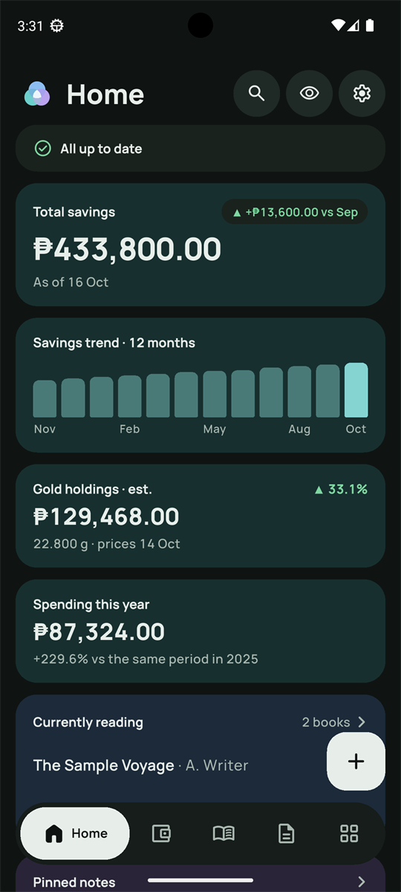
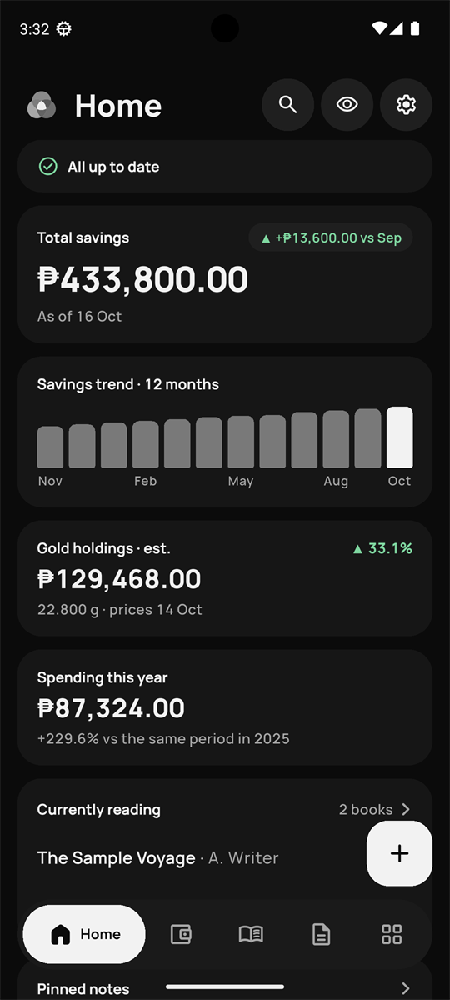
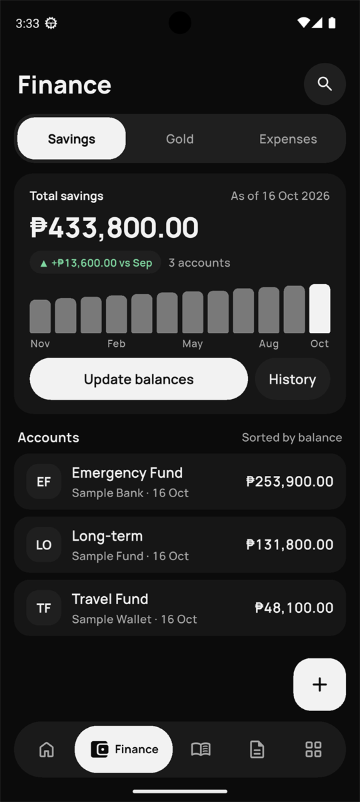

<p align="center">
  <picture>
    <source media="(prefers-color-scheme: dark)" srcset="design/brand/ozone-mark-dark.svg">
    
  </picture>
</p>

<h1 align="center">OZONE</h1>

<p align="center">
  <b>Money, books, notes and recipes, bonded in one app.</b><br>
  A personal, private, offline-only Android app. No account, no cloud, no internet permission.
</p>

<p align="center">
  <a href="../../releases/latest">Download the APK</a> ·
  <a href="#features">Features</a> ·
  <a href="#privacy">Privacy</a> ·
  <a href="#build-it-yourself">Build it yourself</a>
</p>

<p align="center">
  
  
  
  
  
</p>

<p align="center"><sub>All screenshots use made-up sample data.</sub></p>

## What it is

Ozone (O₃) is three oxygen atoms bonded into one molecule. OZONE started the same way, three everyday tools bonded
into one calm app, and gained a fourth in 1.2:

- **Finance** tracks savings, gold and expenses.
- **Library** keeps your books and your reading.
- **Notes** holds checklists and notes, with a locked vault for the private ones.
- **Recipes** keeps your recipes, reads printed ones from a photo, and tells you what you can cook.

Everything stays on your phone. You export backups yourself: a `.zip` holding an ordinary `.xlsx` workbook, which opens
in any spreadsheet app, and your recipe photos.

## Features

### Finance

<p>
  
</p>

- **Savings:** accounts with month-end balances, a 12-month trend, change versus last month, and a History report
  across five years. Update all balances at once in a single step.
- **Gold:** items by karat and weight, today's estimated value from your own karat prices, and gain against cost.
- **Expenses:** this year so far against the same period last year, filters by vendor, amount and refunds, and a
  yearly report.
- **Month-end reminder:** one optional notification a month. It never shows amounts.

<br clear="right">

### Library

<p>
  
</p>

- Books with author, status (reading, not started, finished, abandoned), half-star ratings, Kindle size and how you
  got the book.
- Stats: Kindle storage, books finished per year, average rating and spending on books.

<br clear="right">

### Notes

<p>
  
</p>

- Folders, tags, pinned notes, checklists and simple formatting. Notes save themselves as you type.
- **Locked notes:** a vault protected by your password (Argon2id + AES-256-GCM), with an optional fingerprint unlock
  and a recovery code.
- Trash keeps deleted notes for 30 days.

<br clear="right">

### Recipes

<p>
  
</p>

- Ingredients in sections, steps, servings, prep and cook times, categories, favourites and one photo per recipe.
- **Scaling:** change the servings and every amount follows (`½ cup` for 4 becomes `¾ cup` for 6).
- **Scan a page:** take a photo of a printed recipe, set its corners, and OZONE reads the text on the phone. You check
  what was read before it becomes a recipe. Works in airplane mode.
- **What can I cook?** Tick what's in your kitchen and your recipes sort into Ready to cook, Missing 1–2 and Needs
  more. Salt, pepper, water and oil count as always there. An optional Home widget shows the top matches.

<br clear="right">

### Across the app

<p>
  
  
  
</p>

- **Home dashboard** with widgets you can show, hide and reorder, plus a "Needs attention" line.
- **Search** across every tool, including exact amounts.
- **Hide amounts** with one tap; every ₱ figure becomes `₱ ••••`.
- **Light, dark and Monochrome** themes. Monochrome keeps only green and red for gains, losses and warnings.
- **Floating bottom bar** with your three favourite tools, and gentle motion that switches off with the phone's
  Reduce motion setting.
- **App lock** with the phone's own screen lock. Screenshots are blocked while the vault is open.
- **Accessibility:** 48 dp touch targets, text up to 200 %, and TalkBack reads amounts in words.

## Privacy

- **No internet permission.** OZONE cannot send anything anywhere.
- **No camera or storage permission.** Photos come through the phone's own camera app and photo picker. Scanned
  pages are read on the phone and never kept.
- **No account, no analytics, no ads.**
- **Your data lives in the app's private storage** and is excluded from cloud backups.
- **You own the backups:** export a workbook whenever you like. Importing shows a preview of every change first, and a
  safety copy is kept before anything is replaced.

## Download

Get the latest signed APK (`…-arm64.apk`) from
[Releases](../../releases/latest) and install it on Android 8.0 or newer. You may
need to allow installs from your browser or file manager. The app is built and tested for Android first; iOS is kept
ready in the code but not released.

## Build it yourself

You need Flutter 3.47.5 (Dart 3.13.4) and the Android SDK; the exact toolchain is listed in
[app/README.md](app/README.md).

```powershell
cd app
flutter pub get --enforce-lockfile
flutter test
flutter run            # on a phone with USB debugging
```

Release builds are signed with a key that is not in this repository. Use your own key, as described in
[app/README.md](app/README.md#release-signing).

## Built with

Flutter · Riverpod · go_router · drift (SQLite with FTS5 search) · flutter_quill · cryptography · excel · archive ·
image_picker · Google ML Kit text recognition (bundled Latin model, works offline). Every
package is pinned to an exact version and checked with osv-scanner before each release.

## How it was made

OZONE was designed and specified before any code was written, then built in reviewed milestones: ten for 1.0, a
UI refresh for 1.1, and four for the Recipe tool in 1.2. The documents are all here:

| Where | What |
|---|---|
| [docs/02-requirements-baseline.md](docs/02-requirements-baseline.md) | Requirements |
| [docs/03-decision-log.md](docs/03-decision-log.md) | Every decision, with its reason |
| [docs/04-ux-architecture.md](docs/04-ux-architecture.md), [docs/05-design-system.md](docs/05-design-system.md) | UX rules and design tokens |
| [docs/spec/](docs/spec/README.md) | The build specification: data, behaviour, architecture, tests, build order |
| [docs/06-design-progress.md](docs/06-design-progress.md) | Build log |
| [design/brand/](design/brand/README.md) | Logo and brand rules |

## Licence

The code is released under the [MIT Licence](LICENSE). The OZONE name and logo are not covered by it; please don't
use them for your own apps. Bundled fonts keep their own licences: Manrope (SIL Open Font Licence 1.1) and Material
Symbols Rounded (Apache-2.0). Text recognition uses Google ML Kit under Google's ML Kit terms.
